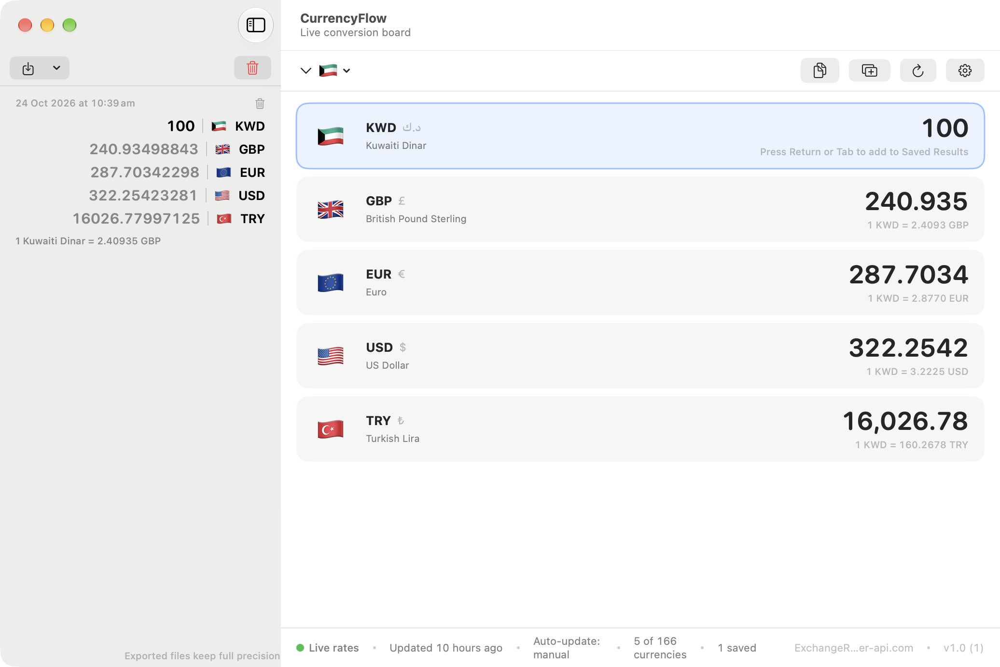
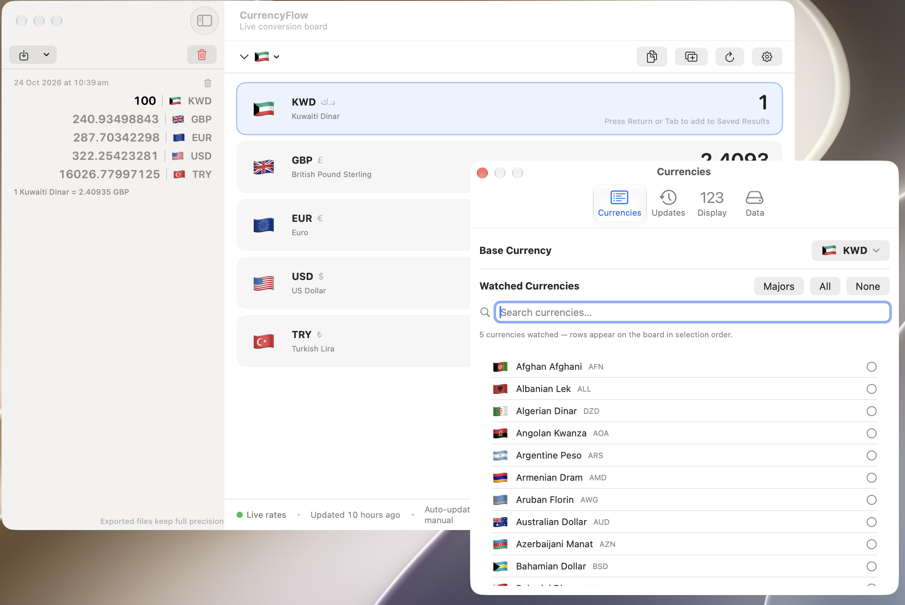
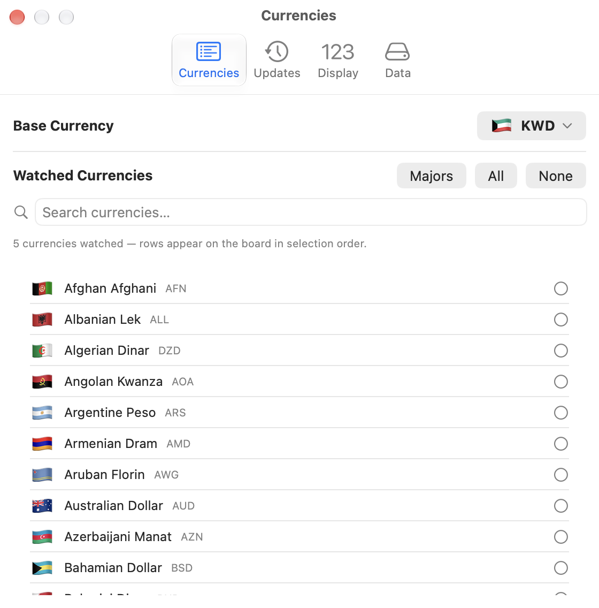

# 💱 CurrencyFlow

A professional, fast and modern **macOS currency-converter app** built with SwiftUI — a live exchange board, saved-results tape, CSV/TXT export and automatic updates from free rate providers. No API keys, no accounts.


---

## ✨ Overview

CurrencyFlow is designed around a simple idea: **type an amount once, see it in every currency you care about.**

- Click any currency row, type an amount, and every other row converts **live**
- Press **Return / Tab** and the whole board is instantly saved to the **Results sidebar**
- Save unlimited boards, review them later, and export everything to **CSV** or **TXT**
- Rates refresh automatically when the app opens and on a schedule — with an offline cache so the board is ready the instant you launch

```
┌───────────────────────────────────────────────┬─────────────────────┐
│  🇰🇼  300 KWD                                 │      300  KWD       │
│  🇬🇧  1,000 GBP                               │    1,000  GBP       │
│  🇪🇺  848.74 EUR                              │    848.74 EUR       │
│  🇺🇸  950.00 USD                              │    950.00 USD       │
│  🇹🇷  47,250.89 TRY                           │ 47,250.89 TRY       │
├───────────────────────────────────────────────┴─────────────────────┤
│ ●  Live rates · Updated 2 min ago · 5 of 160 currencies · v1.0      │
└─────────────────────────────────────────────────────────────────────┘
```

---

## 🚀 Features

| | |
| --- | --- |
| **Live conversion board** | Every watched currency is a row. Click and type in any row — all others convert instantly. Press **Return** to save the board. |
| **Base currency** | Set it once from the top bar or Settings; it persists between launches. |
| **Full currency database** | 160+ ISO-4217 currencies with display names, symbols and flag emojis. |
| **Custom watchlist** | Choose exactly the currencies you want, with search, plus quick **Majors / All / None** actions. |
| **Saved Results sidebar** | Hit Return/Tab to save any board. Each entry shows the *full* conversion (every currency), a rate note and a timestamp. |
| **Export** | One-click export of all saved boards to **CSV** (machine-friendly flat table) or **TXT** (pretty blocks). Full precision — never rounded. |
| **Auto updates** | Rates refresh on launch (toggleable) and on a schedule: hourly / 6 h / 12 h / 24 h. Manual refresh any time. |
| **Offline cache** | Latest rates are cached on disk — the board works instantly on the next launch, even with no network. |
| **Provider fallback** | Three free providers, tried in order, no configuration needed. |
| **Status bar** | Connection state, last update, next scheduled update, currency counts, saved count, active provider and app version. |
| **Polished settings** | Four tabs: Currencies, Updates, Display (decimal places, sort order), Data. |
| **Arabic-friendly input** | Type amounts with Arabic-Indic digits (٣٠٠) — they parse seamlessly. |

---

## ⌨️ Keyboard shortcuts

| Shortcut | Action |
| --- | --- |
| **Return / Tab** | Save the current board to the Results sidebar *(while typing in a row)* |
| **⌘ R** | Refresh rates now |
| **⌘ S** | Save the current board |
| **⇧⌘ Y** | Copy the whole board as text (`300 KWD = 1,000 GBP = 848.74 EUR …`) |

---

## 🌐 Rate providers

All providers are free public APIs — no key required. The app tries them in order:

| # | Provider | Coverage | Notes |
| --- | --- | --- | --- |
| 1 | [ExchangeRate-API](https://open.er-api.com) · `open.er-api.com` | ~160 currencies | Primary, updates daily |
| 2 | [Currency-API](https://github.com/fawazahmed0/currency-api) via jsDelivr CDN | ~200 currencies | First fallback |
| 3 | [Frankfurter](https://frankfurter.app) (European Central Bank) | ~30 majors | Final fallback |

The active provider is shown live in the status bar and in **Settings → Updates**.

---

# Screenshots
### Main View


### Setting View


### Setting 2


---

## 🛠 Getting started

### Requirements
- macOS 14.0 (Sonoma) or newer
- Xcode 27 (or any recent Xcode with Swift 5 support)

### Build & run

```bash
git clone https://github.com/<your-username>/CurrencyFlow.git
cd CurrencyFlow
open CurrencyFlow.xcodeproj
```

Then press **⌘ R** in Xcode — or build from the command line:

```bash
xcodebuild -project CurrencyFlow.xcodeproj -target CurrencyFlow -configuration Release build
open build/Release/CurrencyFlow.app
```

> The app is **sandboxed** with *Outgoing Network (Client)* enabled so it can reach the rate providers.

---

## 📁 Project structure

```
CurrencyFlow/
├── CurrencyFlow.xcodeproj
├── README.md
└── CurrencyFlow/Classes/
    ├── CurrencyFlowApp.swift    # App entry, window, menu commands, settings scene
    ├── ContentView.swift        # Conversion board, header, status bar
    ├── SidebarView.swift        # Saved Results tape (full-board rendering)
    ├── SettingsView.swift       # 4-tab settings (Currencies / Updates / Display / Data)
    ├── Store.swift              # Central state: conversion, settings, persistence, export
    ├── RatesService.swift       # Providers, fallbacks and disk cache
    ├── CurrencyData.swift       # 160+ currency metadata (names, symbols, flags)
    ├── Models.swift             # Value types (records, snapshot, intervals)
    └── Components.swift         # Export/clipboard helpers, base-currency picker
```

---

## ⚙️ How it works

- Live rates are stored **per 1 USD** from the provider and converted on the fly with cross rates — changing your base or anchor currency never requires a refetch.
- Conversions are set by the *anchor row* (the row you're typing in); every other row is `amount × rate[target] / rate[anchor]`.
- Saved boards persist to `~/Library/Application Support/CurrencyFlow/saved-conversions.json`.
- Rate cache: `~/Library/Application Support/CurrencyFlow/rates-cache.json`.
- Settings persist in `UserDefaults` under the `cf.*` keys.

## 🔒 Privacy

CurrencyFlow collects **no personal data** and uploads nothing. It only fetches public exchange rates over HTTPS. Everything else (saved boards, settings, cache) stays on your Mac.

## 📄 License

© Mohammad Alkhaldi — London 2026. All rights reserved.
